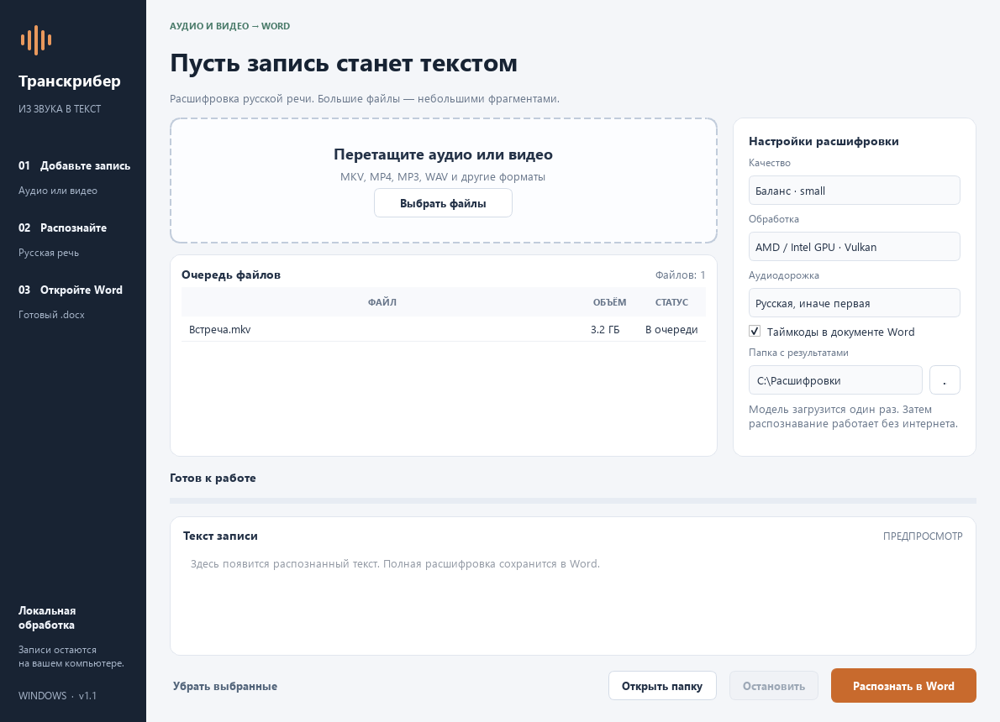

# Транскрибер для Windows

Локальная расшифровка **русской речи из аудио и видео в документ Word**. Перетащите запись в окно, выберите устройство обработки и получите `.docx` с абзацами и необязательными таймкодами.

**[Скачать готовую версию для Windows](https://github.com/clear-killl/transcriber/releases/latest)** · [Сообщить об ошибке](https://github.com/clear-killl/transcriber/issues)



## Содержание

- [Возможности](#возможности)
- [Быстрый запуск](#быстрый-запуск)
- [Системные требования](#системные-требования)
- [CPU и видеокарты](#cpu-и-видеокарты)
- [Качество и модели](#качество-и-модели)
- [Большие MKV и аудиодорожки](#большие-mkv-и-аудиодорожки)
- [Word и абзацы](#word-и-абзацы)
- [Остановка и продолжение](#остановка-и-продолжение)
- [Перенос на другой ПК](#перенос-на-другой-пк)
- [Интернет и локальные данные](#интернет-и-локальные-данные)
- [Исходники и сборка](#исходники-и-сборка)
- [Командная строка](#командная-строка)
- [Тесты и ограничения](#тесты-и-ограничения)
- [Решение проблем](#решение-проблем)
- [Устройство проекта](#устройство-проекта)

## Возможности

- Русскоязычный интерфейс, перетаскивание файлов и очередь нескольких записей.
- MKV, MP4, MP3, WAV, M4A, FLAC, OGG, WEBM, MOV, AVI и другие форматы, доступные медиадекодеру.
- Обработка больших файлов частями, без загрузки всей записи в память.
- Выбор русской аудиодорожки по метке языка или ручной выбор номера.
- CPU, NVIDIA CUDA и совместимые AMD/Intel GPU через Vulkan.
- Автоматическое обнаружение доступных Vulkan-видеокарт.
- Предпросмотр текста и экспорт `.docx` с абзацами, таймкодами и нумерацией страниц.
- Контрольные точки, продолжение работы и частичный Word при остановке.
- Локальное распознавание после загрузки модели; API-ключи и подписка не нужны.

Программа рассчитана на **расшифровку русской речи**. Перевод с других языков и автоматическое разделение по говорящим пока не реализованы.

## Быстрый запуск

1. Откройте [последний релиз](https://github.com/clear-killl/transcriber/releases/latest).
2. В разделе Assets скачайте **`Transcriber-1.1.0-Windows-x64.zip`**.
3. Распакуйте архив целиком, например в «Документы». У приложения должно быть право записи в свою папку.
4. Запустите `Transcriber\Transcriber.exe`.
5. Перетащите аудио или видео в окно.
6. При необходимости измените качество, устройство, аудиодорожку и папку результата.
7. Нажмите **«Распознать в Word»**.
8. Дважды нажмите на готовую строку, чтобы открыть документ, либо нажмите **«Открыть папку»**.

В релиз **1.1.0** включена модель **small / «Баланс»** в двух форматах: CPU/NVIDIA и Vulkan. С ней можно начать работу без скачивания модели. Другие модели загружаются при первом выборе.

**Code → Download ZIP содержит исходники.** Для запуска без установки Python скачивайте архив приложения из Releases. Один `Transcriber.exe` без соседних папок работать не будет.

## Системные требования

| Компонент | Требование |
| --- | --- |
| ОС | Windows x64; готовая сборка проверена под Windows 10 |
| CPU | Процессор x64; отдельная видеокарта не обязательна |
| Память | Зависит от модели; начните с `base` или `small` |
| Диск | Место для распакованной программы, моделей и документов |
| AMD / Intel GPU | Совместимая карта и актуальный драйвер с поддержкой Vulkan 1.3 |
| NVIDIA GPU | CUDA-видеокарта и совместимые библиотеки CUDA/cuDNN для CTranslate2 |
| Word | Для создания `.docx` Microsoft Word не нужен; для просмотра нужен совместимый редактор |
| Python / .NET | Для готового релиза отдельно устанавливать не требуется |

Старые встроенные Intel HD могут не иметь подходящего Vulkan-драйвера. В таком случае используйте CPU. Скорость и расход памяти зависят от оборудования, модели и качества записи.

## CPU и видеокарты

| Вариант в «Обработка» | Движок | Назначение |
| --- | --- | --- |
| Процессор (CPU) | faster-whisper / CTranslate2, INT8 | Универсальный режим без настройки GPU |
| Видеокарта NVIDIA (CUDA) | faster-whisper / CTranslate2, FP16 | NVIDIA с настроенными CUDA/cuDNN |
| Название карты · Vulkan | whisper.cpp через Whisper.net | AMD Radeon и совместимая встроенная/дискретная Intel |

При запуске приложение в фоне получает список **Vulkan GPU** и добавляет названия в список устройств. При нескольких GPU можно выбрать нужный. Совместимая NVIDIA также может появиться в Vulkan-списке; CUDA остаётся отдельным пунктом.

**Автоопределение не означает автовыбор самой быстрой карты.** Изначально используется CPU, затем запоминается ваш выбор. Наличие пункта CUDA не подтверждает, что NVIDIA и её библиотеки настроены. Если Vulkan-карты не найдены, остаётся общий пункт «AMD / Intel GPU · Vulkan»; при запуске выводится сообщение об ошибке.

Для Vulkan не нужны CUDA, ROCm или OpenVINO. Требуется подходящий видеодрайвер. При ошибке программа не подменяет выбранный GPU на CPU: выберите CPU вручную.

Документация движков: [faster-whisper](https://github.com/SYSTRAN/faster-whisper), [Vulkan в whisper.cpp](https://github.com/ggml-org/whisper.cpp#vulkan-gpu-support), [Whisper.net](https://github.com/sandrohanea/whisper.net).

## Качество и модели

| В интерфейсе | Модель | Особенности |
| --- | --- | --- |
| Быстро | `base` | Лёгкая модель для чернового текста и менее мощного оборудования |
| Баланс | `small` | Стартовый вариант, включённый в релиз |
| Точнее | `medium` | Более тяжёлая модель; на CPU может работать заметно медленнее |
| Максимум | `large-v3` | Самая тяжёлая из доступных моделей, требует больше памяти |

Название режима отражает размер модели, а не гарантию точности. Шум, музыка, одновременная речь, имена и числа могут вызывать ошибки во всех режимах.

CPU/NVIDIA и Vulkan используют **разные форматы весов**:

- `data/models` — faster-whisper для CPU/NVIDIA;
- `data/models-vulkan` — GGML для Vulkan.

Для отсутствующей модели нужен интернет и свободное место — от сотен мегабайт до нескольких гигабайт. Затем она используется локально. На слабой встроенной графике начните с `base` или `small`; встроенный GPU не обязательно быстрее CPU.

## Большие MKV и аудиодорожки

Искусственного ограничения размера файла нет. Поддержка зависит от целостности контейнера, аудиокодека, памяти для модели и свободного места.

Программа читает только выбранную звуковую дорожку: видеоряд не декодируется. Звук приводится к моно, 16 кГц, и обрабатывается фрагментами по **5 минут с перекрытием 2 секунды**. На перекрытиях используются временные метки слов, когда они доступны.

Один аудиобуфер занимает около **19 МБ**, независимо от общей длительности записи. Это не общий расход памяти: дополнительно нужны модель, рабочие буферы движка и память для экспорта Word.

В режиме CPU/NVIDIA огромный временный WAV не создаётся. Vulkan-компонент получает только WAV текущего фрагмента; он удаляется после обработки или отмены.

Автоматически выбирается дорожка с меткой `ru` / `rus`, иначе первая. Для MKV с несколькими озвучками выберите **«Аудиодорожка № …»** вручную. Номер относится только к звуку, без видео и субтитров. Без языковых меток программа не угадывает, какая озвучка русская.

Таймкоды отсчитываются от начала выбранной аудиодорожки. Задержки и разрывы временной шкалы контейнера не воспроизводятся отдельными промежутками.

## Word и абзацы

Результат — обычный редактируемый **`.docx`**. В документ входят название файла, дата, модель, аудиодорожка, текст, необязательные таймкоды `[00:12:34]`, нумерация страниц и отметка о машинном распознавании.

**Каждый распознанный речевой фрагмент сохраняется отдельным абзацем.** Это границы фрагментов распознавания, а не смысловая редактура по темам. Спикеры автоматически не подписываются.

Пример:

> [00:00:04] Сегодня обсудим планы на следующую неделю.
>
> [00:00:11] Сначала проверим выполненные задачи.

Для документа без временных меток снимите флажок **«Таймкоды в документе Word»** перед запуском.

По умолчанию документы сохраняются в `results` рядом с приложением; папку можно изменить. Имя имеет вид `Интервью — расшифровка.docx`. При совпадении добавляется номер, существующий документ не заменяется.

## Остановка и продолжение

- **«Остановить»** отменяет текущую очередь.
- CPU/NVIDIA проверяет отмену между возвращаемыми фрагментами модели. Текущая операция или загрузка может завершиться не сразу.
- У Vulkan завершается дочерний GPU-процесс и удаляется временный WAV.
- Завершённые фрагменты сохраняются в `data/checkpoints`.
- Если завершён хотя бы один фрагмент, создаётся `… — частично.docx`.
- Незавершённый фрагмент при следующем запуске обрабатывается заново.

Для продолжения добавьте **тот же файл по тому же пути с теми же настройками**. Контрольная точка учитывает путь, размер, время изменения, модель, устройство и настройки. Перемещение, изменение файла или настроек создаёт другую задачу.

Звук при продолжении читается с начала, но сохранённые фрагменты не распознаются повторно. Удаление `data/checkpoints` убирает возможность продолжения. При закрытии занятого окна сначала запрашивается остановка.

## Перенос на другой ПК

Переносите **всю папку `Transcriber`**, сохраняя структуру:

```text
Transcriber/
├── Transcriber.exe
├── _internal/             # Python, Qt, медиабиблиотеки, зависимости
├── runtime/
│   └── vulkan/            # Автономный GPU-компонент AMD/Intel
├── data/
│   ├── models/            # Модели CPU/NVIDIA
│   └── models-vulkan/     # Модели Vulkan
├── README.md
└── THIRD_PARTY_NOTICES.md
```

`data/settings.json`, журналы `.log` и `data/checkpoints` не обязательны для запуска. На другом ПК настройки удобно задать заново. Архив релиза не содержит персональных настроек и промежуточных расшифровок.

Исходники, `.venv`, `build`, тесты и скрипты сборки на другом ПК не нужны. `runtime` нужен для AMD/Intel. Без моделей приложение сможет скачать веса при доступе к интернету. После переноса заново выберите устройство и папку результатов.

## Интернет и локальные данные

Аудио и видео обрабатываются на компьютере. В коде приложения нет отправки записей в облачный сервис. API-ключи и подписка не требуются. Интернет нужен для установки из исходников и загрузки отсутствующих моделей с Hugging Face; со скачанной моделью распознавание работает без сети.

| Путь | Содержимое |
| --- | --- |
| `data/settings.json` | Настройки и путь к результатам |
| `data/models` | Кеш моделей CPU/NVIDIA |
| `data/models-vulkan` | Кеш моделей Vulkan |
| `data/checkpoints` | SQLite с распознанными фрагментами |
| `data/transcriber.log` | Журнал приложения; может содержать пути к файлам |
| `data/vulkan-worker.log` | Диагностика GPU-компонента |
| `results` | Документы Word, если не выбрана другая папка |

При передаче рабочей папки другим людям проверьте документы, контрольные точки, настройки и журналы: в них могут быть ваши тексты и пути. Скрипт упаковки релиза включает только программу, документацию и, при запросе, модели.

## Исходники и сборка

Для исходников нужны Git и **Python 3.12 x64**. Для сборки GPU-компонента дополнительно нужен **.NET 10 SDK**.

```powershell
git clone https://github.com/clear-killl/transcriber.git
cd transcriber
powershell.exe -NoProfile -ExecutionPolicy Bypass -File .\setup.ps1
.\start.cmd
```

`setup.ps1` создаёт `.venv` и устанавливает `requirements.txt`. `start.cmd` также запускает установку, если окружения или зависимостей ещё нет. Системные пакеты Python не изменяются.

CPU/NVIDIA доступны после установки Python-зависимостей. Для AMD/Intel один раз соберите компонент:

```powershell
powershell.exe -NoProfile -ExecutionPolicy Bypass -File .\build-gpu.ps1
.\start.cmd
```

Отдельная установка FFmpeg не требуется: медиабиблиотеки поставляются с PyAV. Показанный запуск PowerShell с `-ExecutionPolicy Bypass` не требует постоянного изменения системной политики.

### Переносимая сборка

Закройте работающий экземпляр приложения перед обновлением EXE и библиотек.

```powershell
powershell.exe -NoProfile -ExecutionPolicy Bypass -File .\build.ps1

# Скопировать уже скачанные модели из каталога разработки
powershell.exe -NoProfile -ExecutionPolicy Bypass -File .\build.ps1 -IncludeCachedModels
```

Результат — `dist/Transcriber`. Скрипт устанавливает зависимости, собирает автономный Vulkan worker, запускает PyInstaller и копирует программу в выходную папку. Существующие `data` и `results` сохраняются.

Чистый архив для распространения:

```powershell
.\.venv\Scripts\python.exe tools\package_release.py --include-models
```

Архив и `SHA256SUMS.txt` появятся в `releases`. Без `--include-models` веса будут загружаться при первом использовании.

### Особенности GPU-сборки

- `native/GpuWorker/packages.lock.json` фиксирует NuGet-версии и контрольные суммы.
- Worker собирается автономно; установленный .NET пользователю не нужен.
- В Vulkan-пакете Whisper.net 1.8.1 CPU-библиотека завершалась с `0xC000001D` на тестовом i5-12400. Скрипт подставляет ABI-совместимую CPU-библиотеку NoAvx того же выпуска. Основная модель и GPU-операции остаются на видеокарте.
- PyInstaller запускается с очищенным `PATH`, чтобы посторонние ICU/DLL не попали в комплект.

## Командная строка

```powershell
# CPU
.\Transcriber.exe --cli --device cpu --model small --output "C:\Расшифровки" "C:\Записи\встреча.mkv"

# Первая Vulkan-видеокарта
.\Transcriber.exe --cli --device vulkan:0 --model small "C:\Записи\встреча.mkv"

# NVIDIA CUDA
.\Transcriber.exe --cli --device cuda --model small "C:\Записи\встреча.wav"

# Несколько файлов
.\Transcriber.exe --cli "C:\Записи\первая.mp3" "C:\Записи\вторая.mp4"
```

Из исходников замените `Transcriber.exe` на `.\.venv\Scripts\python.exe -m transcriber`.

| Параметр | Значение |
| --- | --- |
| `--cli` | Обработка без окна |
| `--device` | `cpu`, `cuda` или `vulkan:N`; по умолчанию `cpu` |
| `--model` | `base`, `small`, `medium`, `large-v3`; по умолчанию `small` |
| `--output` | Папка Word; по умолчанию `results` рядом с программой |
| `--data-dir` | Другая папка моделей, контрольных точек и журналов |

У GUI-сборки нет консольного окна; пути и ошибки CLI записываются в журнал. Для проверки кода завершения:

```powershell
$job = Start-Process -FilePath .\Transcriber.exe -ArgumentList '--cli --device cpu "C:\Записи\пример.wav"' -Wait -PassThru
$job.ExitCode
```

`0` — успех, `1` — ошибка обработки. В CLI включены таймкоды и автоматический выбор аудиодорожки; дополнительные настройки доступны в интерфейсе.

## Тесты и ограничения

```powershell
.\.venv\Scripts\python.exe -m pip install -r requirements-dev.txt
.\.venv\Scripts\python.exe -m pytest -q
```

В версии 1.1.0 проходят **17 тестов**: WAV и MKV с двумя дорожками, ограниченный буфер, перекрытия, контрольные точки, отмена, Word с кириллицей, очередь, выбор устройств, протокол GPU-процесса и очистка временных файлов. Настоящая видеокарта для этих тестов не нужна.

| Проверка на оборудовании | Состояние |
| --- | --- |
| CPU → русский текст → Word | Проверено, включая готовый EXE |
| AMD Radeon RX 6700 XT, Windows 10 | Проверено на MKV с двумя дорожками; журнал подтверждает Vulkan backend и GPU-память модели |
| Intel GPU | Тот же Vulkan backend; отдельная физическая проверка не проводилась |
| NVIDIA CUDA | Реализовано; отдельная физическая проверка в этом окружении не проводилась |
| Многочасовой пользовательский MKV | Тестируется механизм чтения частями, а не все возможные контейнеры и длительности |

Проверка настоящей моделью:

```powershell
.\.venv\Scripts\python.exe tools\smoke_transcribe.py "C:\Записи\пример.wav" small
.\.venv\Scripts\python.exe tools\smoke_transcribe.py "C:\Записи\пример.mkv" small vulkan:0
```

Проверьте важные имена, числа и неразборчивые места перед использованием документа. Программа не выполняет смысловую редактуру, перевод с других языков на русский, распознавание говорящих или извлечение встроенных субтитров.

## Решение проблем

| Проблема | Что проверить |
| --- | --- |
| EXE не запускается после переноса | Наличие `_internal` и `runtime` рядом с EXE, Windows x64 |
| Нет карты в Vulkan-списке | Драйвер, Vulkan 1.3, доступность карты системе; временно выберите CPU |
| Ошибка AMD/Intel GPU | Обновите драйвер, уменьшите модель, прочитайте `data/vulkan-worker.log` |
| Ошибка CUDA / cuDNN / cuBLAS | [Требования faster-whisper к NVIDIA](https://github.com/SYSTRAN/faster-whisper#gpu) или режим CPU |
| Не скачивается модель | Доступ к Hugging Face и файловому хранилищу, сеть и свободное место |
| Долго нет текста | Возможна загрузка модели и обработка первого фрагмента; большие модели на CPU тяжелее |
| Нет речи или распознан другой язык | Аудиодорожку, наличие русской речи и качество звука |
| Нет доступа к результатам | Выберите доступную папку, закройте документ в Word, если он мешает файловой операции |
| Продолжение начинается заново | Путь, размер, время изменения, настройки и наличие `data/checkpoints` |
| После отмены нет частичного Word | Возможно, ни один полный фрагмент ещё не завершён |
| Много коротких абзацев | Это границы речевых фрагментов; смысловая группировка пока не реализована |

В Issues укажите версию приложения, Windows, модель, устройство и текст ошибки. Перед публикацией журнала уберите личные пути и содержимое записей.

## Устройство проекта

```text
transcriber/          # GUI, декодирование, движки, контрольные точки и Word
native/GpuWorker/     # Vulkan-компонент на C#
tests/                # Автоматические проверки без настоящего GPU
tools/                # Проверки моделью, превью и упаковка релиза
docs/                 # Иллюстрация интерфейса
setup.ps1             # Окружение Python
start.cmd             # Запуск из исходников
build-gpu.ps1         # Сборка Vulkan worker
build.ps1             # Сборка переносимой программы
requirements*.txt     # Зависимости
```

Сборки, модели, записи, документы, настройки и контрольные точки не входят в Git-репозиторий. Готовая программа публикуется отдельно в [Releases](https://github.com/clear-killl/transcriber/releases).

Сведения о сторонних компонентах: [THIRD_PARTY_NOTICES.md](THIRD_PARTY_NOTICES.md). Сохраняйте уведомления и лицензии зависимостей при передаче сборки.
